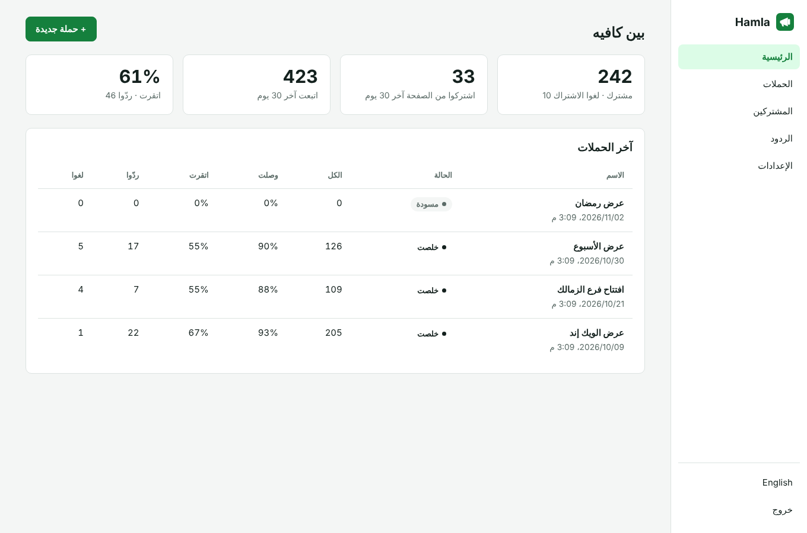
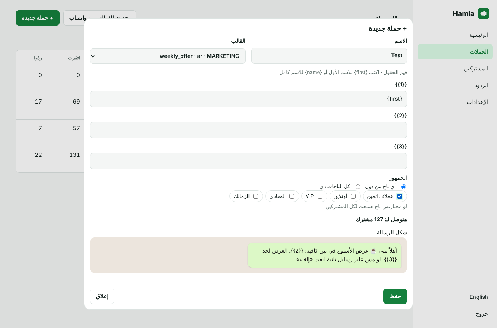
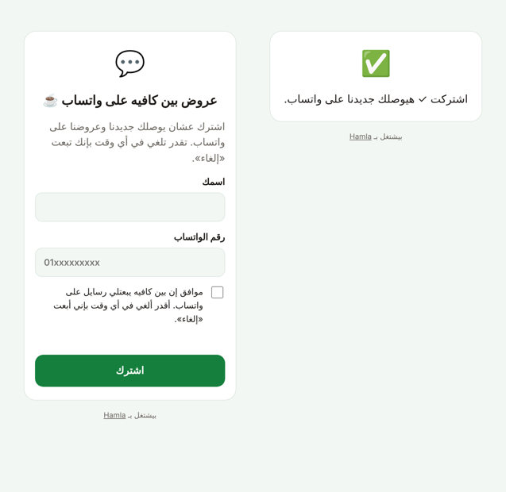
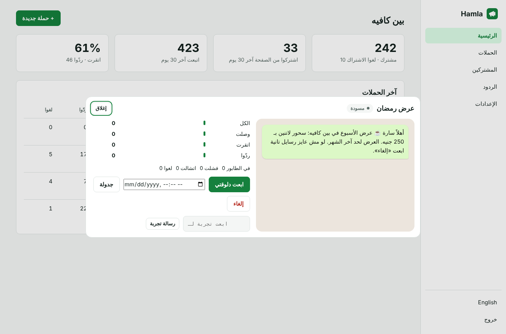
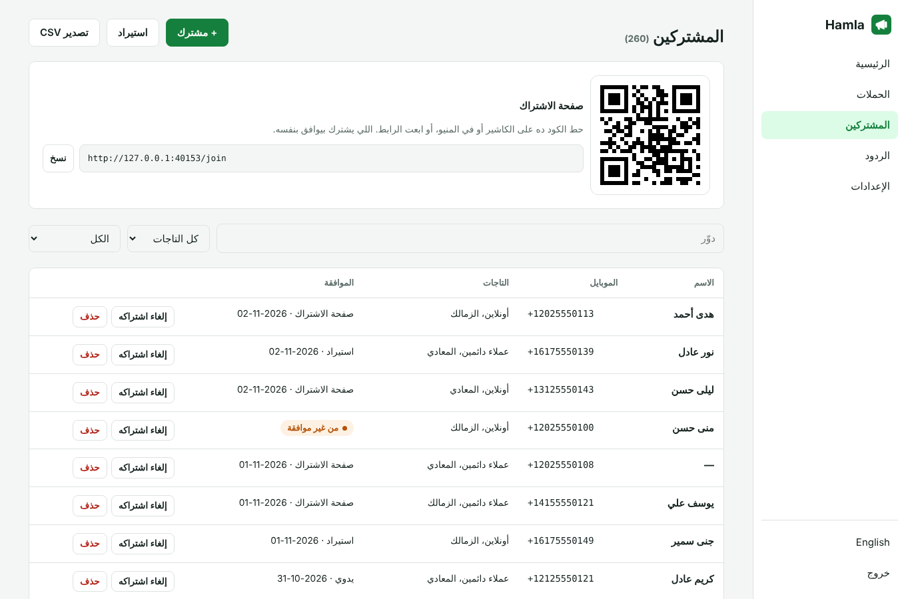

<div align="center">

# Hamla · حملة

**WhatsApp campaigns the official way.**
Subscribers with recorded consent, a sign-up page with a QR code, Meta-approved templates with the customer's name in them, paced sending outside quiet hours, delivered, read and reply tracking, and automatic unsubscribe when someone sends "stop". Self-hosted, built on the WhatsApp Cloud API.

[](https://www.hostinger.com/docker-hosting?compose_url=https://raw.githubusercontent.com/mashraf1997/hamla/main/docker-compose.yml&REFERRALCODE=YOUR_REFERRAL_CODE)

[English](#how-it-works) · [العربية](#بالعربي)



</div>

---

## How it works

1. **Connect your WhatsApp Business number** through Meta's Cloud API (step-by-step guide in Settings). Hamla uses the official API only: no WhatsApp Web, no unofficial libraries, no banned numbers.
2. **Collect subscribers.** Print the QR code at the till or on the menu, or share the link. People type their number and tick the consent box themselves. You can also import a list or add someone by hand, and Hamla asks you to confirm they agreed.
3. **Refresh templates.** Marketing messages on WhatsApp must use templates approved by Meta. Create them in WhatsApp Manager; Hamla pulls in the approved ones.
4. **Create a campaign:** pick a template, fill its fields (`{first}` puts each customer's first name in), choose tags, see how many people it reaches and how the message looks.
5. **Send now or schedule it.** Hamla sends at the pace you set, waits out quiet hours, and pauses the whole campaign if the token expires instead of failing every message.
6. **Follow it:** sent, delivered, read and replied for every message, and the replies in one inbox. Anyone who answers "stop" or «إلغاء» is unsubscribed at once and skipped by every later campaign.

## Features

- **Subscribers:** tags, consent source and date for each person, search and filters, CSV import (Arabic or English headers, local numbers turned into international ones) and export.
- **Sign-up page and QR code** in your business name, with an optional tag per QR (for example one per branch).
- **Campaigns:** approved templates with text fields and image headers, audiences by any or all tags, a preview, a test message to your own number, scheduling, pause, resume and cancel.
- **Tracking** from WhatsApp's own webhook, signed with your app secret: delivered, read, failed (with the reason), replies and unsubscribes per campaign.
- **Safe sending:** messages per minute, quiet hours in your time zone, one message per number per campaign, nobody without consent or who said stop.
- Arabic and English, right-to-left ready.

<p align="center">
  
  
</p>
<p align="center"></p>
<p align="center"></p>

## Before you start: Meta's rules

Hamla is built to keep you inside WhatsApp's [Business Messaging Policy](https://business.whatsapp.com/policy), but who you message is still your responsibility:

- **Only message people who agreed** to hear from you on WhatsApp. Do not import bought lists or numbers collected for something else.
- **Use templates Meta approved.** Meta charges per template message by category and country; check the current [pricing](https://developers.facebook.com/docs/whatsapp/pricing).
- **Make leaving easy.** Mention in the template that people can reply "stop". Hamla handles the rest.
- Numbers that get many blocks or reports lose quality rating and messaging limits. Start small, send to people who know you, and keep messages useful.

## Setup

1. Deploy (below) on a domain with HTTPS. Meta only sends webhooks to HTTPS.
2. In [developers.facebook.com](https://developers.facebook.com) create a **Business** app and add **WhatsApp**. Add and verify your business phone number.
3. Copy the **Phone number ID** and **WhatsApp Business Account ID** into Hamla's Settings.
4. In Business Settings create a **System User**, give it your app and WhatsApp account, and generate a permanent token with `whatsapp_business_messaging` and `whatsapp_business_management`. Paste it in Settings, with the **App Secret** from App Settings → Basic.
5. In WhatsApp → Configuration set the **Callback URL** and **Verify token** shown in Settings and subscribe to **messages**.
6. Create a template in WhatsApp Manager, wait for approval, then press **Refresh templates** in Hamla.

## Deploy

**One click:** press **Deploy on Hostinger** above, open `http://YOUR-SERVER-IP` and create your password. Then put it behind a domain with HTTPS (Settings shows the webhook address to give Meta).

**Docker:**

```bash
git clone https://github.com/mashraf1997/hamla.git && cd hamla
docker compose up -d
```

**Node.js 20+:** `npm install && npm start`

| Variable | Default | Purpose |
|---|---|---|
| `PORT` | `3000` | HTTP port |
| `DATA_DIR` | `./data` | Where `hamla.json` is stored. Back it up. |
| `SETUP_TOKEN` | *(empty)* | Required to create the first admin when set |
| `DEMO_MODE` | `false` | `true` makes this a public demo: a sample café, nothing is ever sent, a reset every hour, and the password and WhatsApp keys locked |
| `DEMO_PASSWORD` | `demo1234` | Password shown on the demo sign-in screen |
| `DEMO_RESET_MINUTES` | `60` | How often the demo data resets (minimum 5) |
| `DEMO_LANG` | `ar` | Language of the sample data: `ar` or `en` |

## Development

```bash
npm install
npm test
```

The tests run against a fake WhatsApp Cloud API (`META_GRAPH_URL`): template sync, consent rules, paced sending with personal fields, signed webhooks, "stop", quiet hours and an expired token. One dependency: `qrcode`.

## More open-source tools for small businesses

[Wakeel](https://github.com/mashraf1997/wakeel) (AI WhatsApp assistant) · [Khatm](https://github.com/mashraf1997/khatm) (loyalty stamps) · [Takyeem](https://github.com/mashraf1997/takyeem) (Google reviews) · [Nashr](https://github.com/mashraf1997/nashr) (social posts) · [Ouda](https://github.com/mashraf1997/ouda) (all of them on one server)

## License

MIT. Not affiliated with WhatsApp or Meta.

---

<div dir="rtl">

## بالعربي

**حملة** بتبعت عروضك على واتساب بالطريقة الرسمية (WhatsApp Cloud API)، من غير ما رقمك يتقفل.

- **المشتركين بموافقتهم:** QR على الكاشير أو لينك، والعميل بيكتب رقمه ويعلّم على الموافقة بنفسه. ولو هتستورد قايمة لازم تأكد إنهم وافقوا.
- **قوالب معتمدة من ميتا** وفيها اسم العميل: «أهلاً منى…».
- **الجمهور بالتاجات:** VIP، فرع المعادي، أونلاين…
- **إرسال هادي:** عدد رسايل في الدقيقة، وساعات هدوء بالليل، وجدولة.
- **المتابعة:** وصلت، اتقرت، ردّوا، وكل الردود في مكان واحد.
- **إلغاء الاشتراك أوتوماتيك:** أي حد يبعت «إلغاء» أو «stop» مبيوصلوش حاجة تاني.

مهم: ابعت بس للناس اللي وافقت، وميتا بتحاسب على كل رسالة قالب حسب البلد والنوع.

</div>
